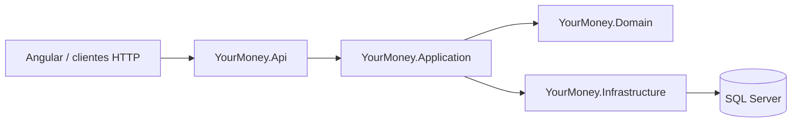

# YourMoney API

API REST do **YourMoney**, uma plataforma de gestão financeira pessoal criada para centralizar receitas, despesas, investimentos e planejamento mensal com isolamento de dados por usuário.

Este repositório contém o backend da aplicação. A interface web está em [YourMoney-angular](https://github.com/juanvecco/YourMoney-angular).

## Principais recursos

- cadastro e autenticação com ASP.NET Core Identity e JWT;
- dados financeiros isolados por usuário autenticado;
- receitas, despesas, categorias e contas financeiras;
- despesas parceladas com distribuição exata dos centavos;
- receitas e despesas recorrentes com sugestões mensais;
- classificação de receitas e controle de reembolsos;
- investimentos e consolidação mensal;
- metas mensais baseadas em percentuais da receita;
- dashboard com agregações financeiras;
- Swagger para explorar e testar os endpoints;
- suporte a Docker e publicação integrada do frontend Angular.

## Arquitetura

O projeto separa responsabilidades em quatro camadas:



| Camada | Responsabilidade |
| --- | --- |
| `YourMoney.Api` | Controllers, autenticação, Swagger e configuração HTTP |
| `YourMoney.Application` | Casos de uso, serviços, DTOs, commands e queries |
| `YourMoney.Domain` | Entidades, regras de negócio, enums e contratos de repositório |
| `YourMoney.Infrastructure` | Entity Framework Core, repositórios, migrations e persistência |

## Tecnologias

- .NET 9 e ASP.NET Core Web API
- Entity Framework Core 9
- SQL Server
- ASP.NET Core Identity e JWT Bearer
- Swagger / OpenAPI
- Docker
- testes de domínio, aplicação, infraestrutura e API

## Estrutura do repositório

```text
src/
├── YourMoney.Api/
├── YourMoney.Application/
├── YourMoney.Domain/
└── YourMoney.Infrastructure/
tests/
└── YourMoney.Tests/
```

## Executando localmente

### Pré-requisitos

- [.NET SDK 9](https://dotnet.microsoft.com/download/dotnet/9.0)
- SQL Server acessível localmente ou remotamente

### 1. Clone e restaure as dependências

```bash
git clone https://github.com/juanvecco/YourMoney.git
cd YourMoney
dotnet restore YourMoney.sln
```

### 2. Configure o ambiente

A API utiliza duas conexões com o SQL Server e configurações de JWT. Defina os valores abaixo por variáveis de ambiente ou em uma configuração local que não seja versionada:

| Variável | Finalidade |
| --- | --- |
| `ConnectionStrings__DefaultConnection` | Dados financeiros da aplicação |
| `ConnectionStrings__IdentityConnection` | Usuários e identidade |
| `JwtSettings__Secret` | Chave de assinatura do token |
| `JwtSettings__Issuer` | Emissor do token |
| `JwtSettings__Audience` | Público do token |
| `JwtSettings__ExpirationInMinutes` | Duração do token em minutos |

### 3. Inicie a API

```bash
dotnet run --project src/YourMoney.Api/YourMoney.Api.csproj
```

Em desenvolvimento, a API usa `https://localhost:5001`. O Swagger fica disponível em `https://localhost:5001/swagger`.

### Inicialização integrada no Windows

Com os repositórios `YourMoney` e `YourMoney-angular` na mesma pasta, use o atalho abaixo para instalar e compilar o frontend, publicar os arquivos no `wwwroot`, aplicar as migrations, iniciar a API e abrir o dashboard:

```powershell
.\abrir-yourmoney.ps1
```

Também é possível executar `abrir-yourmoney.cmd` ou informar outro caminho para o frontend com `-FrontendPath`.

## Build e testes

```bash
dotnet build YourMoney.sln --configuration Release
dotnet run --project tests/YourMoney.Tests/YourMoney.Tests.csproj --configuration Release
```

Os testes são executados por um runner próprio e cobrem regras financeiras, autorização, isolamento entre usuários, contratos HTTP e persistência.

## Docker

```bash
docker build -t yourmoney-api .
docker run --rm -p 8080:8080 \
  -e ConnectionStrings__DefaultConnection="<connection-string>" \
  -e ConnectionStrings__IdentityConnection="<connection-string>" \
  -e JwtSettings__Secret="<secret>" \
  -e JwtSettings__Issuer="YourMoney" \
  -e JwtSettings__Audience="YourMoney" \
  -e JwtSettings__ExpirationInMinutes="60" \
  yourmoney-api
```

## Frontend

O cliente Angular está disponível em [juanvecco/YourMoney-angular](https://github.com/juanvecco/YourMoney-angular).

## Status

Projeto em evolução contínua, usado para desenvolver e demonstrar uma solução full stack de finanças pessoais.
